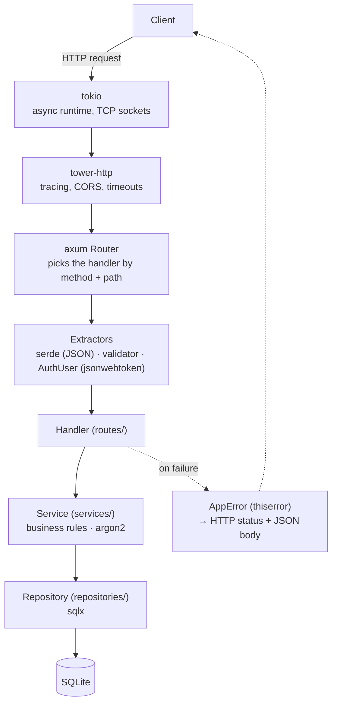
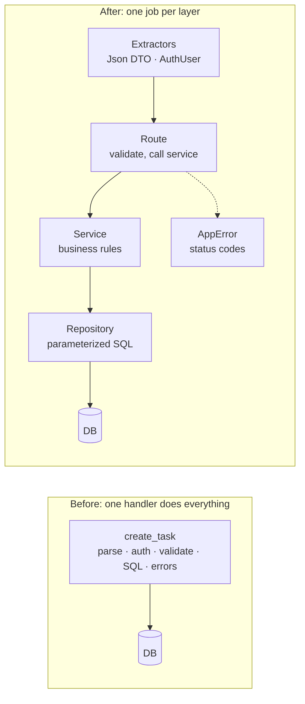

# Dependencies Guide: Task Tracker (Rust + Axum)

This guide explains every crate in the Task Tracker's starter set:

- what it's for
- a working example
- what good and bad usage looks like, and why

[Part 2](#part-2-anatomy-of-bad-backend-code) takes a deliberately bad handler and fixes it step by step.

> **Version note.** The examples follow the APIs of the versions pinned in the
> install commands below (axum 0.8, sqlx 0.8, argon2 0.5, jsonwebtoken 9, and so on).
> They haven't been compile-checked. If you upgrade a crate to a new major version
> and something stops compiling, check that crate's CHANGELOG first. Rust crates
> often make breaking changes between `0.x` versions.

---

## Where each crate sits in a request

Follow one request from the client to the database and back. Each box names the crates involved at that step.



A few crates don't appear in the diagram because they run on every step or only at startup:

- `tracing` produces logs everywhere along the path.
- `dotenvy` loads config once, at startup.
- `uuid` and `chrono` provide types used by every layer.
- `anyhow` handles errors in startup code.

---

## Installing the starter set

```bash
# Versions are pinned to the APIs this guide was written against.
cargo add tokio@1 --features full
cargo add axum@0.8
cargo add tower-http@0.6 --features trace,cors,timeout
cargo add serde@1 --features derive
cargo add serde_json@1
cargo add sqlx@0.8 --features runtime-tokio,sqlite,uuid,chrono,migrate
cargo add validator@0.20 --features derive
cargo add thiserror@2 anyhow@1 dotenvy@0.15 argon2@0.5 jsonwebtoken@9
cargo add tracing@0.1
cargo add tracing-subscriber@0.3 --features env-filter
cargo add uuid@1 --features v4,v7,serde
cargo add chrono@0.4 --features serde

# The sqlx command-line tool, for creating and running migrations:
cargo install sqlx-cli --no-default-features --features sqlite
```

**Why features matter.** Rust crates ship optional pieces behind feature flags, so you only compile what you use. `sqlx` can talk to Postgres, MySQL and SQLite. Turning on only `sqlite` keeps the build small and the dependency tree short.

---

# Part 1: The crates

## 1. `tokio`: the async runtime

**Purpose.** A web server spends most of its time waiting: for the network, for the database, for the disk. Async Rust lets one thread switch to other work while a request waits, instead of sitting idle. However, Rust's `async fn` doesn't run by itself. It needs a runtime to schedule it, and tokio is that runtime. It runs a small pool of worker threads, typically one per CPU core, and moves tasks between them as they become ready.

**Example**

```rust
#[tokio::main] // Starts the runtime and runs main() inside it.
async fn main() -> anyhow::Result<()> {
    let app = build_router().await?;
    let listener = tokio::net::TcpListener::bind("0.0.0.0:3000").await?;
    axum::serve(listener, app).await?;
    Ok(())
}
```

**Good practice**

- **Use async versions of I/O.** Use `tokio::time::sleep`, `tokio::fs` and async DB drivers. Inside async code, never use their blocking `std` equivalents.
- **Move CPU-heavy or blocking work off the async threads** with `tokio::task::spawn_blocking`. Password hashing is the classic example (see [argon2](#9-argon2-password-hashing)).
- **Handle the result of spawned tasks.** `tokio::spawn` returns a `JoinHandle`. If you drop it, any error or panic inside the task disappears silently.

**Bad practice**

```rust
// BAD: blocks a runtime worker thread for 1 second.
// With 8 workers, eight of these calls at the same time freeze the
// whole server. Every other request waits, even simple ones.
async fn handler() {
    std::thread::sleep(std::time::Duration::from_secs(1));
}

// GOOD: yields the thread back to tokio while waiting.
async fn handler() {
    tokio::time::sleep(std::time::Duration::from_secs(1)).await;
}
```

**Rule of thumb.** If an operation can take more than about 100 microseconds without an `.await` in it, it's blocking. Move it to `spawn_blocking`.

---

## 2. `axum`: routing, extractors and responses

**Purpose.** axum maps HTTP requests to your functions. It is built on three ideas:

- **Router**: matches `GET /tasks/{id}` to a handler function.
- **Extractors**: handler arguments such as `Json<T>`, `Path<T>`, `Query<T>` and `State<T>`. axum parses the request into them before your code runs. If parsing fails, axum rejects the request with a 4xx error and your handler never runs.
- **IntoResponse**: anything a handler returns, such as a struct, a tuple or a `Result`, gets converted into an HTTP response.

**Example**

```rust
use axum::{
    extract::{Path, State},
    routing::get,
    Json, Router,
};
use sqlx::SqlitePool;
use std::sync::Arc;
use uuid::Uuid;

// Shared state: created once at startup, cloned cheaply into every request.
// SqlitePool is internally reference-counted, and the config sits behind an Arc,
// so cloning AppState never copies the actual data.
#[derive(Clone)]
pub struct AppState {
    pub db: SqlitePool,
    pub config: Arc<Config>,
}

pub fn router(state: AppState) -> Router {
    Router::new()
        .route("/tasks", get(list_tasks).post(create_task))
        // axum 0.8 uses {id} for path parameters. Older tutorials use :id.
        .route("/tasks/{id}", get(get_task).patch(update_task).delete(delete_task))
        .with_state(state)
}

// The handler's signature *is* its input contract. Reading it tells you this
// endpoint needs the DB (via state), a logged-in user, and a UUID in the path.
async fn get_task(
    State(state): State<AppState>,
    user: AuthUser,       // Custom extractor (see the jsonwebtoken section)
    Path(id): Path<Uuid>, // A non-UUID path is rejected with 400 before this runs
) -> Result<Json<TaskResponse>, AppError> {
    let task = task_repo::find_for_user(&state.db, id, user.id)
        .await?
        .ok_or(AppError::NotFound)?;
    Ok(Json(task.into()))
}
```

**Good practice**

- **Keep handlers thin.** A handler should read the input, call a service, and shape the response. Business logic goes in services and SQL goes in repositories. That way you can test the logic without HTTP.
- **Return `Result<T, AppError>`** from handlers so the `?` operator works and every error converts to a proper status code in one place.
- **Put the body extractor last.** `Json<T>` consumes the request body, so axum requires it to be the last argument.
- **Share resources through `State`.** Use it for the DB pool, config and HTTP clients. Never use globals.

**Bad practice**

- **Global mutable state** such as `static mut`, or a `lazy_static` holding a `Mutex<Vec<Task>>`. It makes tests interfere with each other. It also disappears when the process restarts, and every server copy behind a load balancer would have different data.
- **Using `Json<serde_json::Value>`** instead of a typed struct. You lose compile-time checks and end up writing `body["title"].as_str().unwrap()` everywhere. See [Part 2](#part-2-anatomy-of-bad-backend-code).
- **Handlers hundreds of lines long**, mixing SQL, hashing and response formatting.

---

## 3. `tower-http`: middleware

**Purpose.** Some concerns apply to every request: logging, CORS, timeouts, compression, request IDs. Instead of repeating that code in each handler, you wrap the whole router in layers. axum is built on the `tower` ecosystem, so any tower middleware works with it.

**Example**

```rust
use axum::http::{HeaderValue, Method};
use tower_http::{cors::CorsLayer, trace::TraceLayer};

let cors = CorsLayer::new()
    .allow_origin("http://localhost:5173".parse::<HeaderValue>().unwrap())
    .allow_methods([Method::GET, Method::POST, Method::PATCH, Method::DELETE]);

let app = router(state)
    .layer(cors)
    // Logs every request (method, path, status, latency) through `tracing`.
    .layer(TraceLayer::new_for_http());
```

**Good practice**

- **Add a request timeout.** One slow database query shouldn't hold a connection open forever. `tower_http::timeout` provides the layer.
- **List exactly which origins CORS allows**, and load the list from config so dev and production differ.
- **Know how layers stack.** Layers wrap from the inside out, so the last `.layer()` call is the outermost layer and sees the request first. Put tracing outermost so it measures everything, including time spent in other middleware.

**Bad practice**

- **`CorsLayer::permissive()` in production.** It allows any website to call your API from a user's browser. It's fine for a local experiment, but it shouldn't ship.
- **Hand-written logging in every handler.** It's inconsistent, easy to forget, and duplicates what `TraceLayer` already does.

---

## 4. `serde` and `serde_json`: (de)serialization

**Purpose.** serde converts between Rust structs and data formats. `#[derive(Deserialize)]` turns incoming JSON into a struct, and `#[derive(Serialize)]` turns a struct into outgoing JSON. axum's `Json<T>` extractor and response both use it.

**Example**

```rust
use serde::{Deserialize, Serialize};

// Incoming: what a client may send to create a task.
#[derive(Deserialize)]
#[serde(deny_unknown_fields)] // Reject typos like "titel" instead of silently ignoring them
pub struct CreateTask {
    pub title: String,
    #[serde(default)] // Missing field becomes None
    pub description: Option<String>,
}

// Outgoing: what clients see. Note that user_id is deliberately absent.
#[derive(Serialize)]
pub struct TaskResponse {
    pub id: Uuid,
    pub title: String,
    pub description: Option<String>,
    pub done: bool,
    pub created_at: DateTime<Utc>,
}
```

**Good practice: keep three kinds of types separate**

| Type | Example | Purpose |
|---|---|---|
| Request DTO | `CreateTask` | What clients may send. Contains only the fields they're allowed to set. |
| Domain / DB model | `Task` | What the database stores. It may hold internal fields. |
| Response DTO | `TaskResponse` | What clients may see. |

This looks like duplication, but each type changes for different reasons. Separating them also prevents the two most common serde security bugs:

1. **Leaking fields.** If `User` derives `Serialize` and you return it directly, `password_hash` ends up in the JSON response.
2. **Mass assignment.** If clients can send `User` directly, someone sends `"is_admin": true` and you save it.

**Bad practice**

```rust
// BAD: one struct used for DB rows, request bodies AND responses.
#[derive(Serialize, Deserialize, sqlx::FromRow)]
pub struct User {
    pub id: Uuid,
    pub email: String,
    pub password_hash: String, // Returned to every client that fetches a user
    pub is_admin: bool,        // Settable by any client that signs up
}
```

As a last line of defense, `#[serde(skip_serializing)]` on secret fields helps, but separate types are the real fix.

---

## 5. `sqlx`: talking to the database

**Purpose.** sqlx sends SQL to the database asynchronously and maps rows into structs. It is not an ORM: you write real SQL. It also gives you:

- **Connection pooling.** Opening a DB connection is slow, so a pool keeps a few connections open and lends them out to requests.
- **Migrations.** These are versioned SQL files that build and evolve the schema.
- **Compile-time query checking** through the `query!` and `query_as!` macros.

**Example: setup (in `main.rs`)**

```rust
use sqlx::sqlite::SqlitePoolOptions;

let pool = SqlitePoolOptions::new()
    .max_connections(5)
    .connect(&config.database_url) // e.g. "sqlite://tasks.db?mode=rwc"
    .await?;

// Applies any migrations in ./migrations that haven't run yet.
sqlx::migrate!("./migrations").run(&pool).await?;
```

**Example: a migration** (create it with `sqlx migrate add create_tasks`)

```sql
-- migrations/20261101000000_create_tasks.sql
CREATE TABLE tasks (
    id          BLOB PRIMARY KEY NOT NULL,
    user_id     BLOB NOT NULL REFERENCES users(id) ON DELETE CASCADE,
    title       TEXT NOT NULL,
    description TEXT,
    done        BOOLEAN NOT NULL DEFAULT FALSE,
    created_at  TEXT NOT NULL
);
CREATE INDEX idx_tasks_user_created ON tasks(user_id, created_at);
```

**Example: a repository function**

```rust
#[derive(Debug, Clone, sqlx::FromRow)]
pub struct Task {
    pub id: Uuid,
    pub user_id: Uuid,
    pub title: String,
    pub description: Option<String>,
    pub done: bool,
    pub created_at: DateTime<Utc>,
}

pub async fn find_for_user(
    db: &SqlitePool,
    id: Uuid,
    user_id: Uuid,
) -> Result<Option<Task>, sqlx::Error> {
    // The `?` placeholders are *parameters*. The values travel to the database
    // separately from the SQL text, so they can never be interpreted as SQL.
    sqlx::query_as::<_, Task>(
        "SELECT id, user_id, title, description, done, created_at
         FROM tasks
         WHERE id = ? AND user_id = ?", // The user_id check enforces ownership
    )
    .bind(id)
    .bind(user_id)
    .fetch_optional(db) // Zero rows gives None, which the caller turns into 404
    .await
}
```

**Example: a transaction** (several writes that must all succeed or all fail)

```rust
let mut tx = pool.begin().await?;
sqlx::query("DELETE FROM task_tags WHERE task_id = ?").bind(id).execute(&mut *tx).await?;
sqlx::query("DELETE FROM tasks WHERE id = ?").bind(id).execute(&mut *tx).await?;
tx.commit().await?; // If we return early with `?`, tx is dropped and rolled back
```

**Good practice**

- **Always use bind parameters** (`?` in SQLite, `$1` in Postgres). Never build SQL with `format!`.
- **Create one pool at startup** and share it through `State`.
- **Name your columns.** `SELECT *` breaks silently when someone adds a column, and it fetches data you don't need.
- **Treat applied migrations as append-only.** To change the schema, add a new migration. Never edit one that already ran.
- **Add indexes for the queries you run.** "List my tasks, newest first" needs `(user_id, created_at)`.
- **Try `query_as!` once you're comfortable.** It checks your SQL against the real schema at compile time. It needs `DATABASE_URL` set while building, or `cargo sqlx prepare` for offline builds.

**Bad practice**

```rust
// BAD: SQL injection. If title is  x'); DROP TABLE tasks; --
// the database receives and runs that as SQL.
let sql = format!("INSERT INTO tasks (title) VALUES ('{}')", title);
sqlx::query(&sql).execute(&pool).await?;

// BAD: "N+1 queries", one query per task inside a loop.
// 100 tasks means 101 round-trips to the database.
for task in &tasks {
    let tags = sqlx::query_as::<_, Tag>("SELECT ... WHERE task_id = ?")
        .bind(task.id).fetch_all(&pool).await?;
}
// GOOD: fetch all the tags in one query (WHERE task_id IN (...), or a JOIN),
// then group them in Rust.
```

---

## 6. `validator`: input validation

**Purpose.** serde checks that the JSON has the right shape (`title` is a string). validator checks that the values are acceptable (`title` isn't empty and isn't 50,000 characters long). The rule is to validate at the boundary, before data reaches your business logic or database.

**Example**

```rust
use validator::Validate;

#[derive(Deserialize, Validate)]
pub struct CreateTask {
    #[validate(length(min = 1, max = 200))]
    pub title: String,
    #[validate(length(max = 2000))]
    pub description: Option<String>,
}

#[derive(Deserialize, Validate)]
pub struct SignupRequest {
    #[validate(email)]
    pub email: String,
    // A max length matters too: hashing a 10 MB "password" ties up your CPU.
    #[validate(length(min = 8, max = 128))]
    pub password: String,
}

// In the handler:
payload.validate()?; // Becomes a 422 with per-field details (see AppError)
```

**Good practice**

- **Choose the right layer for each rule.** Format rules go in DTOs with validator, such as "title is 1 to 200 characters". Rules that need the database or the current state go in services, such as "you can't complete a task in an archived project".
- **Return all errors at once, per field**, so clients can highlight every bad input.
- **Always set a maximum length.** Unbounded strings are a denial-of-service risk.

**Bad practice**

- **Validating only in the frontend.** Anyone can call your API directly with `curl` and skip the frontend entirely.
- **Validating deep inside the repository**, after half the work is done. Invalid data should be stopped at the door.

---

## 7. `thiserror` and `anyhow`: errors

**Purpose.** These two crates solve different problems:

- **`thiserror`** builds your own error enum with meaningful variants (`NotFound`, `Unauthorized`...) that code can `match` on. Use it for errors you need to handle differently.
- **`anyhow`** is a "some error happened, with context" type for code where you won't match on the error, only report it. Use it in startup code and one-off scripts.

In axum, the payoff is one `AppError` type that implements `IntoResponse`. Every handler returns `Result<T, AppError>`, uses `?` freely, and the mapping from errors to HTTP status codes lives in exactly one place.

**Example: `error.rs`**

```rust
use axum::{http::StatusCode, response::{IntoResponse, Response}, Json};
use serde_json::json;

#[derive(Debug, thiserror::Error)]
pub enum AppError {
    #[error("not found")]
    NotFound,

    #[error("invalid credentials")]
    Unauthorized,

    #[error("{0}")]
    Conflict(String),

    // #[from] generates From<ValidationErrors>, so `payload.validate()?` works
    #[error("validation failed")]
    Validation(#[from] validator::ValidationErrors),

    #[error(transparent)]
    Database(#[from] sqlx::Error),

    #[error(transparent)]
    Internal(#[from] anyhow::Error),
}

impl IntoResponse for AppError {
    fn into_response(self) -> Response {
        let (status, body) = match &self {
            AppError::NotFound => (StatusCode::NOT_FOUND, json!({ "error": "not found" })),
            AppError::Unauthorized => {
                (StatusCode::UNAUTHORIZED, json!({ "error": "invalid credentials" }))
            }
            AppError::Conflict(msg) => (StatusCode::CONFLICT, json!({ "error": msg })),
            AppError::Validation(errors) => (
                StatusCode::UNPROCESSABLE_ENTITY,
                json!({ "error": "validation failed", "details": errors }),
            ),
            // Unexpected failures: log the full details for *us*,
            // send a generic message to the *client*.
            AppError::Database(_) | AppError::Internal(_) => {
                tracing::error!(error = ?self, "request failed");
                (
                    StatusCode::INTERNAL_SERVER_ERROR,
                    json!({ "error": "internal server error" }),
                )
            }
        };
        (status, Json(body)).into_response()
    }
}
```

**Example: `anyhow` in startup code**

```rust
use anyhow::Context;

let pool = SqlitePoolOptions::new()
    .connect(&config.database_url)
    .await
    .context("failed to connect to the database")?; // Adds a readable explanation
```

**Good practice**

- **Distinguish expected from unexpected errors.** Expected errors such as not found, bad input or a duplicate email get a specific status and a helpful message. Unexpected errors get a 500, a generic message, and a detailed log.
- **Add `.context(...)`** with `anyhow` so a failure at startup says what was being attempted, not just "No such file or directory".

**Bad practice**

```rust
// BAD: panics. In axum, a panic kills that request's task and the client
// gets a dropped connection or an empty 500, with no useful log message.
let task = repo::find(&db, id).await.unwrap();

// BAD: leaks internals. The client sees table names, SQL and file paths,
// which is useful to an attacker and confusing to a user.
Err(e) => (StatusCode::INTERNAL_SERVER_ERROR, e.to_string())

// BAD: everything is anyhow, so a "not found" can't become a 404.
// Every failure turns into the same 500.
async fn get_task(...) -> Result<Json<Task>, anyhow::Error>
```

`.unwrap()` and `.expect()` are fine in tests, and at startup for things that genuinely can't proceed. A missing `DATABASE_URL` should crash immediately with a clear `expect` message.

---

## 8. `dotenvy`: configuration from `.env`

**Purpose.** Configuration that differs between your laptop and production, such as the database URL, secrets and the port, should come from environment variables, never from source code. `dotenvy` loads a local `.env` file into the environment so development stays convenient.

**Example: `config.rs`**

```rust
use anyhow::Context;

pub struct Config {
    pub database_url: String,
    pub jwt_secret: String,
    pub port: u16,
}

impl Config {
    pub fn from_env() -> anyhow::Result<Self> {
        // The .env file is optional (production usually has none), and real
        // environment variables always win over values in .env.
        dotenvy::dotenv().ok();

        Ok(Self {
            database_url: std::env::var("DATABASE_URL").context("DATABASE_URL must be set")?,
            jwt_secret: std::env::var("JWT_SECRET").context("JWT_SECRET must be set")?,
            port: std::env::var("PORT")
                .unwrap_or_else(|_| "3000".into())
                .parse()
                .context("PORT must be a number")?,
        })
    }
}
```

```bash
# .env.example: committed, documents what's needed
DATABASE_URL=sqlite://tasks.db?mode=rwc
JWT_SECRET=change-me-to-a-long-random-string
PORT=3000
RUST_LOG=task_tracker=debug,tower_http=info
```

**Good practice**

- **Read config once at startup into a typed struct, and fail fast.** A server that starts with a missing secret and fails on the first login is worse than one that refuses to start.
- **Keep secrets out of git.** Put `.env` in `.gitignore`, and commit `.env.example` with placeholder values.

**Bad practice**

- **`std::env::var("X")` scattered through handlers.** The config becomes undiscoverable, and a typo only surfaces at runtime, in production.
- **A default for secrets**, such as `.unwrap_or("secret".into())` for `JWT_SECRET`. One day production runs with the default, and anyone can forge tokens.
- **Committing `.env`.** Secrets in git history are effectively public forever, even after you delete the file.

---

## 9. `argon2`: password hashing

**Purpose.** Never store passwords, only a hash of them. Hashing is one-way, so even if your database leaks, attackers don't get the passwords directly. Argon2 is a deliberately slow, memory-hungry hash. That makes guessing billions of passwords per second on GPUs impractical. Fast hashes such as SHA-256 are the wrong tool here precisely because they're fast.

**Example**

```rust
use argon2::{
    password_hash::{rand_core::OsRng, PasswordHash, PasswordHasher, PasswordVerifier, SaltString},
    Argon2,
};

pub async fn hash_password(password: String) -> anyhow::Result<String> {
    // Argon2 is CPU-heavy on purpose (tens of milliseconds), so run it on
    // tokio's blocking thread pool, not on an async worker. See the tokio section.
    tokio::task::spawn_blocking(move || {
        // A random salt per user means identical passwords get different hashes.
        let salt = SaltString::generate(&mut OsRng);
        Argon2::default()
            .hash_password(password.as_bytes(), &salt)
            .map(|hash| hash.to_string()) // The string includes algorithm, params and salt
            .map_err(|e| anyhow::anyhow!("password hashing failed: {e}"))
    })
    .await?
}

pub async fn verify_password(password: String, stored_hash: String) -> anyhow::Result<bool> {
    tokio::task::spawn_blocking(move || {
        let parsed = PasswordHash::new(&stored_hash)
            .map_err(|e| anyhow::anyhow!("stored hash is malformed: {e}"))?;
        Ok(Argon2::default()
            .verify_password(password.as_bytes(), &parsed)
            .is_ok())
    })
    .await?
}
```

**Good practice**

- **Use `spawn_blocking`** for both hashing and verifying.
- **Return the same error for "no such email" and "wrong password"**, so attackers can't discover which emails have accounts. This is called user enumeration.
- **Rely on the PHC string format.** The stored string (`$argon2id$v=19$m=...`) records its own parameters, so you can strengthen settings later without breaking existing hashes.

**Bad practice**

- **Plaintext passwords**, or comparing with `stored == submitted`.
- **Fast or unsalted hashes** such as MD5 or SHA-256 without a salt.
- **Hashing on the async thread.** Under a burst of logins, every other request stalls.
- **Writing your own crypto.** Always use a vetted crate.

---

## 10. `jsonwebtoken`: authentication tokens

**Purpose.** After login, the client needs proof of identity for later requests. A JWT is a signed token containing claims such as "this is user X, valid until time T". The server checks the signature with its secret, so it can trust the claims without a database lookup.

**Example: issue and verify**

```rust
use jsonwebtoken::{decode, encode, DecodingKey, EncodingKey, Header, Validation};

#[derive(Serialize, Deserialize)]
pub struct Claims {
    pub sub: Uuid,  // "subject": the user id
    pub exp: usize, // Expiry as a Unix timestamp. Validation rejects expired tokens.
}

pub fn issue_token(user_id: Uuid, secret: &str) -> anyhow::Result<String> {
    let exp = (chrono::Utc::now() + chrono::Duration::hours(1)).timestamp() as usize;
    let claims = Claims { sub: user_id, exp };
    Ok(encode(&Header::default(), &claims, &EncodingKey::from_secret(secret.as_bytes()))?)
}

pub fn verify_token(token: &str, secret: &str) -> Result<Claims, AppError> {
    decode::<Claims>(token, &DecodingKey::from_secret(secret.as_bytes()), &Validation::default())
        .map(|data| data.claims)
        .map_err(|_| AppError::Unauthorized)
}
```

**Example: an `AuthUser` extractor.** This is where axum's design pays off.

```rust
use axum::{extract::FromRequestParts, http::{header, request::Parts}};

pub struct AuthUser {
    pub id: Uuid,
}

// Implementing FromRequestParts turns AuthUser into an extractor. Any handler
// that lists `user: AuthUser` as an argument is automatically protected:
// with no valid token, the handler never runs and the client gets a 401.
impl FromRequestParts<AppState> for AuthUser {
    type Rejection = AppError;

    async fn from_request_parts(parts: &mut Parts, state: &AppState) -> Result<Self, Self::Rejection> {
        let token = parts
            .headers
            .get(header::AUTHORIZATION)
            .and_then(|value| value.to_str().ok())
            .and_then(|value| value.strip_prefix("Bearer "))
            .ok_or(AppError::Unauthorized)?;

        let claims = verify_token(token, &state.config.jwt_secret)?;
        Ok(AuthUser { id: claims.sub })
    }
}
```

**Good practice**

- **Use short expiry times** (minutes to an hour). JWTs can't be revoked easily before they expire, because the server doesn't store them.
- **Use a long, random secret** loaded from config.
- **Put the ownership check in the query** (`WHERE user_id = ?`), not only in the token. The token proves who the user is, and the query enforces what they may access.

**Bad practice**

- **Sensitive data in the payload.** JWTs are signed, not encrypted. Anyone can base64-decode one and read its contents.
- **No `exp` claim**, which makes a leaked token valid forever.
- **Disabling signature validation**, or accepting the `none` algorithm.
- **Using a user-supplied ID as identity**, such as an `X-User-Id` header. Anyone can type any ID. See Part 2.

> **JWT or sessions?** The alternative is `tower-sessions`. The server stores a session and gives the client an opaque ID in a cookie. Sessions are easy to revoke ("log out everywhere") and keep tokens out of JavaScript's reach, but they need storage. JWTs need no storage but are hard to revoke. For a single-server app with a browser frontend, sessions are often the simpler and safer choice. This is a design decision to make together when you build the auth stage.

---

## 11. `tracing` and `tracing-subscriber`: logging

**Purpose.**

- `tracing` produces structured events (key-value fields, not just text) and spans, which are units of work like "handling request 42".
- `tracing-subscriber` decides where those events go and in what format: the terminal while developing, JSON for log systems in production.

**Example: setup (in `main.rs`)**

```rust
use tracing_subscriber::EnvFilter;

tracing_subscriber::fmt()
    .with_env_filter(
        // RUST_LOG controls verbosity per crate, with a sensible default.
        EnvFilter::try_from_default_env()
            .unwrap_or_else(|_| EnvFilter::new("task_tracker=debug,tower_http=info")),
    )
    .init();
```

**Example: usage**

```rust
// #[instrument] opens a span for each call. Every log line inside it
// automatically carries user_id, so you can filter logs to one user.
#[tracing::instrument(skip(db, payload), fields(user_id = %user_id))]
pub async fn create(db: &SqlitePool, user_id: Uuid, payload: CreateTask) -> Result<Task, AppError> {
    // ...
    tracing::info!(task_id = %task.id, "task created"); // Structured fields, not format!()
    Ok(task)
}
```

**Good practice**

- **Use structured fields** (`task_id = %id`) so log tools can search and filter on them.
- **Match the level to the meaning.** `error!` means a developer needs to look at this. A 404 is normal traffic and is at most `debug!`.
- **Use `skip(...)` in `#[instrument]`** for large or sensitive arguments.

**Bad practice**

- **`println!` for logging.** It has no levels, no timestamps, no filtering and no request context.
- **Logging secrets**, such as passwords, tokens, full `Authorization` headers or entire request bodies. Logs are copied to many systems and kept for a long time.
- **Logging an error and also returning it at every layer.** One failure shows up as five log lines. Log it once, at the edge (`AppError::into_response`).

---

## 12. `uuid` and `chrono`: IDs and time

**Purpose.**

- `uuid` generates IDs that are unique without asking the database, and that can't be guessed.
- `chrono` handles dates and times with time zones.

**Example**

```rust
use chrono::{DateTime, Utc};
use uuid::Uuid;

let task = Task {
    id: Uuid::now_v7(), // Time-ordered UUID. New rows land at the end of the index.
    user_id,
    title: payload.title,
    description: payload.description,
    done: false,
    created_at: Utc::now(), // Always store UTC
};
```

**Good practice**

- **Store and compute in UTC.** Convert to a user's local time zone only when displaying.
- **Prefer UUID v7 for primary keys.** Its time ordering keeps database indexes efficient. Fully random v4 IDs scatter inserts across the index.

**Bad practice**

- **Local time or "naive" timestamps** without a zone. Daylight-saving changes and servers in different regions then produce wrong times.
- **Relying on unguessable IDs for security.** UUIDs make IDs hard to guess, but authorization (`WHERE user_id = ?`) is what actually protects data.

---

## Other crates you'll meet later (one line each)

| Crate | Purpose |
|---|---|
| `axum-extra` | Extra extractors: cookies, typed headers, query-string helpers |
| `tower-sessions` | Server-side sessions (the alternative to JWTs) |
| `secrecy` | Wraps secrets so they can't be printed or logged by accident |
| `reqwest` | HTTP client for calling other APIs |
| `redis` / `fred` | Redis client for caching and rate-limit counters |
| `tower_governor` | Rate limiting as a tower layer |
| `apalis` | Background job queues and workers |
| `utoipa` | Generates OpenAPI (Swagger) docs from your code |
| `opentelemetry` + `tracing-opentelemetry` | Tracing requests across multiple services |
| `axum-test`, `testcontainers`, `wiremock`, `insta` | Endpoint tests, real databases in Docker, fake external APIs, snapshot tests |

---

# Part 2: Anatomy of bad backend code

The code below compiles, and in a quick demo it even works. Every problem in it, though, shows up regularly in real codebases and incident reports. Each numbered comment marks a problem, and the table after the code explains each one.

## The bad version

```rust
// routes.rs: everything in one place
use axum::{extract::State, http::HeaderMap, Json};
use sqlx::SqlitePool;

async fn create_task(
    State(pool): State<SqlitePool>,
    headers: HeaderMap,
    Json(body): Json<serde_json::Value>,                       // [1] untyped body
) -> String {                                                  // [2] always HTTP 200
    let user_id = headers
        .get("x-user-id").unwrap()                             // [3] identity chosen by the client
        .to_str().unwrap();                                    // [4] panics on bad input
    let title = body["title"].as_str().unwrap();               // [4] [5] panic, no validation

    let sql = format!(
        "INSERT INTO tasks (user_id, title) VALUES ('{}', '{}')",
        user_id, title                                         // [6] SQL injection
    );
    match sqlx::query(&sql).execute(&pool).await {
        Ok(_) => "ok".to_string(),
        Err(e) => format!("error: {}", e),                     // [7] leaks DB internals, still 200
    }
}

async fn list_tasks(State(pool): State<SqlitePool>) -> String {
    let rows: Vec<(String, String)> =
        sqlx::query_as("SELECT * FROM tasks")                  // [8] every user's tasks, [9] no limit
            .fetch_all(&pool).await.unwrap();                  // [4] (also: SELECT * vs a 2-tuple)
    format!("{:?}", rows)                                      // [1] not even JSON
}

async fn login(
    State(pool): State<SqlitePool>,
    Json(body): Json<serde_json::Value>,
) -> String {
    let email = body["email"].as_str().unwrap_or("");
    let password = body["password"].as_str().unwrap_or("");

    std::thread::sleep(std::time::Duration::from_secs(1));     // [10] "anti brute-force" blocks the runtime

    let row: Option<(String, String)> = sqlx::query_as(
        &format!("SELECT id, password FROM users WHERE email = '{}'", email), // [6]
    )
    .fetch_optional(&pool).await.unwrap();

    match row {
        None => "no such user".into(),                         // [11] user enumeration
        Some((id, stored)) if stored == password => {          // [12] plaintext passwords
            println!("login: {} / {}", email, password);       // [13] logs a password, println
            id                                                 // [14] the "token" is the user id
        }
        Some(_) => "wrong password".into(),                    // [11]
    }
}
```

## What goes wrong, and the fix

| # | Problem | What happens in production | Fix (and where) |
|---|---|---|---|
| 1 | `serde_json::Value` in, `String` out | No compile-time checks. Clients must guess the format. Every field access is a possible panic. | Typed DTOs with `serde` (§4) |
| 2 | Always returns 200 | Clients, monitoring and load balancers think failures succeeded. Retries and alerts never trigger. | `Result<T, AppError>` with real status codes (§7) |
| 3 | Trusts `X-User-Id` from the client | Anyone can act as anyone by changing one header. This is a complete authentication bypass. | `AuthUser` extractor verifying a signed token (§10) |
| 4 | `.unwrap()` on input and DB results | A malformed request or a DB hiccup panics the task. The client gets a dropped connection and you get no useful log. | `?` with `AppError`. Bad input becomes a 4xx. |
| 5 | No validation | Empty titles, 10 MB titles, garbage data saved permanently. | `validator` on the DTO (§6) |
| 6 | SQL built with `format!` | SQL injection. A crafted email like `' OR '1'='1` changes the query's meaning. Data can be read, changed or deleted. | Bind parameters in `sqlx` (§5) |
| 7 | `e.to_string()` sent to the client | Reveals table names, SQL and file paths to attackers. Users see confusing messages. | Log the details, return a generic 500 (§7) |
| 8 | No ownership filter | Every user sees every other user's tasks. This is called IDOR (insecure direct object reference). | `WHERE user_id = ?` in the repository (§5) |
| 9 | No pagination | Works with 10 rows. With 1 million rows, a single request exhausts memory and times out. | `LIMIT`/`OFFSET` (or cursor pagination) with a capped limit |
| 10 | `std::thread::sleep` in async | Blocks a runtime worker. A few failed logins at once freeze the whole server, which turns the "protection" into a denial-of-service. | Rate limiting with `tower_governor`. If you must wait, use `tokio::time::sleep` (§1). |
| 11 | Different messages for unknown email vs wrong password | Attackers can probe which emails are registered. | Same `Unauthorized` error for both (§9) |
| 12 | Plaintext passwords | One database leak exposes every user's password, often reused on other sites. | `argon2` hashes (§9) |
| 13 | Password in logs via `println!` | Secrets copied into every log system. There's no level, no structure, no filtering. | `tracing` with structured fields and no secrets (§11) |
| 14 | User id used as the session token | Tokens are guessable and never expire. Combined with [3], anyone can be anyone. | Signed, expiring JWT, or a server-side session (§10) |

The root cause behind most of these: **everything lives in one function**, so no layer is responsible for anything. Parsing, identity, validation, SQL and error handling are all tangled together. Each mistake is easy to make, and hard to spot in review.



## The improved version

The same three endpoints, split into layers. Each piece uses the types from Part 1 (`AppError`, `AuthUser`, `hash_password` / `verify_password`, `issue_token`).

### `routes/tasks.rs`: HTTP only

```rust
use axum::{extract::{Query, State}, http::StatusCode, Json};
use serde::Deserialize;
use validator::Validate;

// Fixes [1] [2] [3] [4] [5]: typed input, typed output, real status codes,
// identity from a verified token, validation before anything else happens.
pub async fn create_task(
    State(state): State<AppState>,
    user: AuthUser,                  // [3] No valid token means a 401 and this never runs
    Json(payload): Json<CreateTask>, // [1] [4] A malformed body is a 4xx, not a panic
) -> Result<(StatusCode, Json<TaskResponse>), AppError> {
    payload.validate()?;             // [5] Bad values are a 422 with field details
    let task = task_service::create(&state.db, user.id, payload).await?;
    Ok((StatusCode::CREATED, Json(task.into()))) // [2] 201 Created, JSON body
}

#[derive(Deserialize)]
pub struct ListParams {
    #[serde(default = "default_limit")]
    pub limit: i64,
    #[serde(default)]
    pub offset: i64,
}
fn default_limit() -> i64 { 20 }

// Fixes [8] [9]: only the caller's tasks, a bounded page at a time.
pub async fn list_tasks(
    State(state): State<AppState>,
    user: AuthUser,
    Query(params): Query<ListParams>, // GET /tasks?limit=20&offset=40
) -> Result<Json<Vec<TaskResponse>>, AppError> {
    let limit = params.limit.clamp(1, 100); // [9] Never trust the client's page size
    let offset = params.offset.max(0);
    let tasks = task_repo::list_for_user(&state.db, user.id, limit, offset).await?;
    Ok(Json(tasks.into_iter().map(TaskResponse::from).collect()))
}
```

### `services/tasks.rs`: business rules

```rust
// No HTTP types here (no StatusCode, no Json). This layer can be tested
// directly and reused from a CLI, a background job or a different API.
pub async fn create(db: &SqlitePool, user_id: Uuid, payload: CreateTask) -> Result<Task, AppError> {
    let task = Task {
        id: Uuid::now_v7(),
        user_id,
        title: payload.title.trim().to_string(), // A small business rule: normalize titles
        description: payload.description,
        done: false,
        created_at: Utc::now(),
    };
    task_repo::insert(db, &task).await?;
    tracing::info!(task_id = %task.id, user_id = %user_id, "task created"); // [13]
    Ok(task)
}
```

### `repositories/tasks.rs`: SQL only

```rust
// Fixes [6] [8]: bind parameters everywhere, and ownership in every query.
pub async fn insert(db: &SqlitePool, task: &Task) -> Result<(), sqlx::Error> {
    sqlx::query(
        "INSERT INTO tasks (id, user_id, title, description, done, created_at)
         VALUES (?, ?, ?, ?, ?, ?)",
    )
    .bind(task.id)
    .bind(task.user_id)
    .bind(&task.title)
    .bind(&task.description)
    .bind(task.done)
    .bind(task.created_at)
    .execute(db)
    .await?;
    Ok(())
}

pub async fn list_for_user(
    db: &SqlitePool,
    user_id: Uuid,
    limit: i64,
    offset: i64,
) -> Result<Vec<Task>, sqlx::Error> {
    sqlx::query_as::<_, Task>(
        "SELECT id, user_id, title, description, done, created_at
         FROM tasks
         WHERE user_id = ?
         ORDER BY created_at DESC
         LIMIT ? OFFSET ?",
    )
    .bind(user_id)
    .bind(limit)
    .bind(offset)
    .fetch_all(db)
    .await
}
```

### `services/auth.rs`: login done right

```rust
// Fixes [10] [11] [12] [13] [14].
pub async fn login(state: &AppState, email: &str, password: String) -> Result<String, AppError> {
    let user = user_repo::find_by_email(&state.db, email).await?; // [6] parameterized

    // [11] The same error whether the email is unknown or the password is wrong.
    let Some(user) = user else {
        return Err(AppError::Unauthorized);
    };

    // [12] Compare against an argon2 hash, computed off the async threads [10].
    if !verify_password(password, user.password_hash).await? {
        return Err(AppError::Unauthorized);
    }

    tracing::info!(user_id = %user.id, "user logged in");     // [13] No password, no email
    Ok(issue_token(user.id, &state.config.jwt_secret)?)       // [14] Signed and expiring
}
```

> **Going further.** The early return for an unknown email is *faster* than a password check. A patient attacker could measure that timing difference to detect registered emails. The standard fix is to verify against a dummy hash when the user doesn't exist, so both paths take the same time. Brute-force protection [10] belongs in a rate-limiting layer (`tower_governor`), not in the handler.

## Takeaways

1. **One job per layer.** Most of the bugs above came from one function doing everything.
2. **Let types do the checking.** Typed DTOs, `Uuid` path params and a `Result` return type turn whole classes of runtime bugs into compile errors or automatic 4xx responses.
3. **Never trust the client.** Its identity claims, its input values and its page sizes all need checking.
4. **Errors are part of the API.** Use the right status code, a helpful message for expected errors, a generic message plus a detailed log for unexpected ones, and never a panic.
5. **Keep secrets out of code, logs and responses.**
